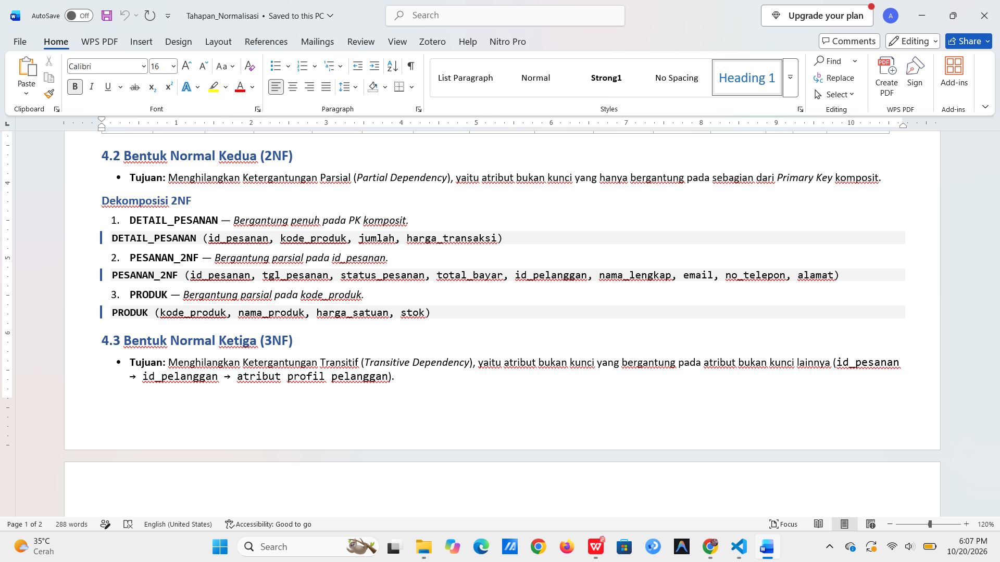
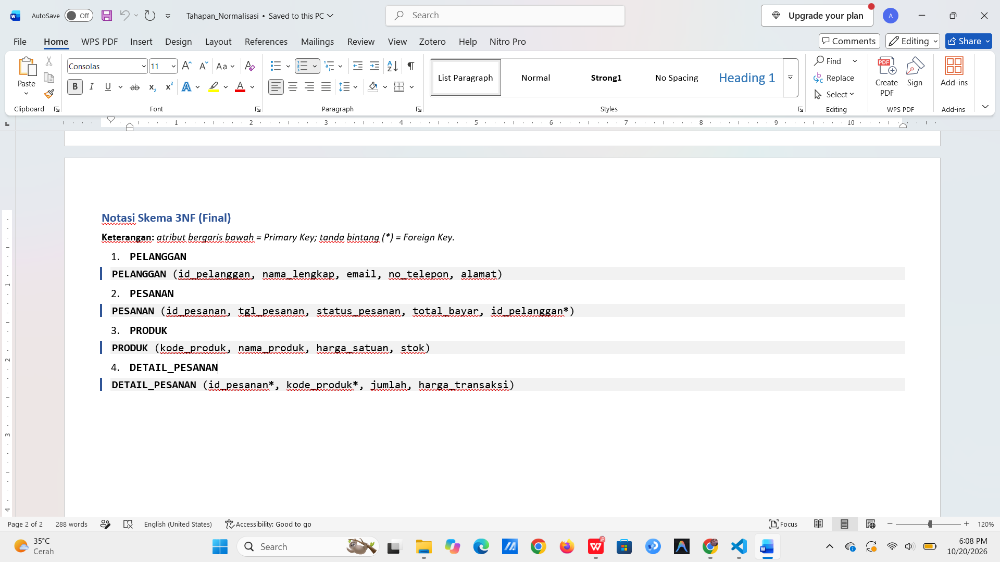

# LAPORAN PRAKTIKUM SISTEM BASIS DATA
  
### Informasi Mahasiswa & Proyek
* **Nama:** Sherly Adi Ramadani  
* **NIM:** 25430100  
* **Kelas:** D  
* **Tema Proyek:** Toko Daring (`toko_100`)  
* **Parameter P:** $1$ *(Rumus Perhitungan: $(00 \bmod 9) + 1 = 1$)*


## 1. Pendahuluan & Aturan Bisnis (*Business Rules*)

Proses normalisasi bertujuan untuk merancang skema basis data yang efisien, terstruktur, serta bebas dari anomali penyisipan (*insertion*), penghapusan (*deletion*), maupun pembaruan (*update*). Pada proyek Toko Daring (`toko_100`), perancangan skema didasarkan pada aturan bisnis berikut:

| Kode Aturan | Deskripsi Aturan Bisnis |
| :---: | :--- |
| **AB-01** | Satu pesanan diidentifikasi secara unik oleh `id_pesanan`, dilakukan oleh tepat satu pelanggan, dan dapat mencakup satu atau lebih item produk. |
| **AB-02** | Satu pelanggan diidentifikasi secara unik oleh `id_pelanggan` dan dapat membuat banyak pesanan dalam kurun waktu berbeda. |
| **AB-03** | Status pesanan mencakup alur transaksi: `Pending`, `Diproses`, `Dikirim`, `Selesai`, dan `Batal`. |
| **AB-04** | Katalog produk mencatat informasi detail produk meliputi nama, harga master (`harga_satuan`), dan jumlah stok. |
| **AB-05** | Atribut `harga_transaksi` pada rincian pesanan menyimpan harga aktual produk pada saat transaksi dilakukan (*historical price*) agar tidak terpengaruh oleh perubahan harga produk di katalog master pada masa mendatang. |


## 2. Dokumen Sumber (UNF — *Unnormalized Form*)

Titik awal analisis diambil dari faktur/nota transaksi transaksi *checkout* pada sistem Toko Daring yang masih memuat kelompok berulang (*repeating groups*).

### 2.1 Notasi Relasi UNF
```text
PESANAN_UNF (
    id_pesanan, tgl_pesanan, status_pesanan, total_bayar,
    id_pelanggan, nama_lengkap, email, no_telepon, alamat,
    { kode_produk, nama_produk, harga_satuan, stok, jumlah, harga_transaksi }
)
```

### 2.2 Tabel Data UNF
| id_pesanan | tgl_pesanan | status_pesanan | total_bayar | id_pelanggan | nama_lengkap | email | no_telepon | alamat | kode_produk | nama_produk | harga_satuan | stok | jumlah | harga_transaksi |
| :--- | :--- | :--- | :--- | :--- | :--- | :--- | :--- | :--- | :--- | :--- | :--- | :--- | :--- | :--- |
| **ORD-001** | 2026-10-15 | Selesai | 350000 | CUST-101 | Budi Santoso | budi@gmail.com | 081234567890 | Jl. Melati No. 5 | PRD-01<br>PRD-02 | Mouse Wireless<br>Keyboard Mech | 100000<br>250000 | 15<br>8 | 1<br>1 | 100000<br>250000 |
| **ORD-002** | 2026-10-16 | Diproses | 200000 | CUST-102 | Siti Rahma | siti@yahoo.com | 082198765432 | Jl. Mawar No. 12 | PRD-01 | Mouse Wireless | 100000 | 15 | 2 | 100000 |
| **ORD-003** | 2026-10-16 | Selesai | 250000 | CUST-101 | Budi Santoso | budi@gmail.com | 081234567890 | Jl. Melati No. 5 | PRD-02 | Keyboard Mech | 250000 | 8 | 1 | 250000 |


## 3. Pemetaan Dependensi Fungsional (*Functional Dependency*)

Berdasarkan aturan bisnis, penentuan *Functional Dependency* (FD) adalah sebagai berikut:
* **FD1:** `id_pesanan` $\rightarrow$ `tgl_pesanan`, `status_pesanan`, `total_bayar`, `id_pelanggan`
* **FD2:** `id_pelanggan` $\rightarrow$ `nama_lengkap`, `email`, `no_telepon`, `alamat`
* **FD3:** `kode_produk` $\rightarrow$ `nama_produk`, `harga_satuan`, `stok`
* **FD4:** (`id_pesanan`, `kode_produk`) $\rightarrow$ `jumlah`, `harga_transaksi`


## 4. Tahapan Normalisasi

### 4.1 Bentuk Normal Pertama (1NF)
* **Tujuan:** Menghilangkan kelompok berulang (*repeating groups*) `{ ... }` sehingga setiap sel bernilai atomik (tunggal), dan membentuk *Primary Key* komposit `(id_pesanan, kode_produk)`.

#### Notasi Skema 1NF
`PESANAN_1NF` ($\underline{\text{id\_pesanan}}, \underline{\text{kode\_produk}}$, tgl_pesanan, status_pesanan, total_bayar, id_pelanggan, nama_lengkap, email, no_telepon, alamat, nama_produk, harga_satuan, stok, jumlah, harga_transaksi)

#### Tabel Data 1NF
| id_pesanan | kode_produk | tgl_pesanan | status_pesanan | total_bayar | id_pelanggan | nama_lengkap | email | no_telepon | alamat | nama_produk | harga_satuan | stok | jumlah | harga_transaksi |
| :--- | :--- | :--- | :--- | :--- | :--- | :--- | :--- | :--- | :--- | :--- | :--- | :--- | :--- | :--- |
| **ORD-001** | **PRD-01** | 2026-10-15 | Selesai | 350000 | CUST-101 | Budi Santoso | budi@gmail.com | 081234567890 | Jl. Melati No. 5 | Mouse Wireless | 100000 | 15 | 1 | 100000 |
| **ORD-001** | **PRD-02** | 2026-10-15 | Selesai | 350000 | CUST-101 | Budi Santoso | budi@gmail.com | 081234567890 | Jl. Melati No. 5 | Keyboard Mech | 250000 | 8 | 1 | 250000 |
| **ORD-002** | **PRD-01** | 2026-10-16 | Diproses | 200000 | CUST-102 | Siti Rahma | siti@yahoo.com | 082198765432 | Jl. Mawar No. 12 | Mouse Wireless | 100000 | 15 | 2 | 100000 |
| **ORD-003** | **PRD-02** | 2026-10-16 | Selesai | 250000 | CUST-101 | Budi Santoso | budi@gmail.com | 081234567890 | Jl. Melati No. 5 | Keyboard Mech | 250000 | 8 | 1 | 250000 |


### 4.2 Bentuk Normal Kedua (2NF)
* **Tujuan:** Menghilangkan Ketergantungan Parsial (*Partial Dependency*), yaitu atribut bukan kunci yang hanya bergantung pada sebagian dari *Primary Key* komposit.

#### Dekomposisi 2NF:
1. **`DETAIL_PESANAN`**: ($\underline{\text{id\_pesanan}}, \underline{\text{kode\_produk}}$, `jumlah`, `harga_transaksi`) — *Bergantung penuh pada PK komposit.*
2. **`PESANAN_2NF`**: ($\underline{\text{id\_pesanan}}$, `tgl_pesanan`, `status_pesanan`, `total_bayar`, `id_pelanggan`, `nama_lengkap`, `email`, `no_telepon`, `alamat`) — *Bergantung parsial pada `id_pesanan`.*
3. **`PRODUK`**: ($\underline{\text{kode\_produk}}$, `nama_produk`, `harga_satuan`, `stok`) — *Bergantung parsial pada `kode_produk`.*



### 4.3 Bentuk Normal Ketiga (3NF)
* **Tujuan:** Menghilangkan Ketergantungan Transitif (*Transitive Dependency*), yaitu atribut bukan kunci yang bergantung pada atribut bukan kunci lainnya (`id_pesanan` $\rightarrow$ `id_pelanggan` $\rightarrow$ atribut profil pelanggan).

#### Notasi Skema 3NF (Final)
1. **`PELANGGAN`**: ($\underline{\text{id\_pelanggan}}$, `nama_lengkap`, `email`, `no_telepon`, `alamat`)
2. **`PESANAN`**: ($\underline{\text{id\_pesanan}}$, `tgl_pesanan`, `status_pesanan`, `total_bayar`, $\text{id\_pelanggan}^*$)
3. **`PRODUK`**: ($\underline{\text{kode\_produk}}$, `nama_produk`, `harga_satuan`, `stok`)
4. **`DETAIL_PESANAN`**: ($\underline{\text{id\_pesanan}}^*, \underline{\text{kode\_produk}}^*$, `jumlah`, `harga_transaksi`)



## 5. Evaluasi BCNF dan Analisis Atribut Turunan

### 5.1 Evaluasi Boyce-Codd Normal Form (BCNF)
Skema berada dalam BCNF jika untuk setiap ketergantungan fungsional $X \rightarrow Y$, maka $X$ adalah *Super Key* atau *Candidate Key*.
* Pada `PELANGGAN`: Determinan adalah `id_pelanggan` (*Primary Key*).
* Pada `PESANAN`: Determinan adalah `id_pesanan` (*Primary Key*).
* Pada `PRODUK`: Determinan adalah `kode_produk` (*Primary Key*).
* Pada `DETAIL_PESANAN`: Determinan adalah (`id_pesanan`, `kode_produk`) (*Composite Primary Key*).

> **Kesimpulan:** Seluruh determinan dalam skema ini adalah *Candidate Key*. Dengan demikian, skema basis data `toko_100` **telah memenuhi standar BCNF**.

### 5.2 Keputusan Atribut Turunan & Nilai Historis
1. **`harga_transaksi` (Disimpan Permanen):** Mengakomodasi harga historis pada saat pemesanan produk terjadi. Hal ini mencegah berfungsinya harga katalog master mempengaruhi transaksi lama jika terjadi kenaikan atau penurunan harga di kemudian hari.
2. **`total_bayar` (Dihitung Dinamis):** Merupakan hasil agregasi `SUM(jumlah * harga_transaksi)`. Disarankan untuk tidak disimpan secara permanen di tabel fisik guna menghindari anomali update, melainkan dihitung secara dinamis melalui SQL View.


## 6. Kamus Data (*Data Dictionary*)

### 1. Tabel `pelanggan`
| Nama Kolom | Tipe Data | Kunci | Deskripsi |
| :--- | :--- | :---: | :--- |
| `id_pelanggan` | `VARCHAR(10)` | **PK** | Identifikasi unik pelanggan |
| `nama_lengkap` | `VARCHAR(100)` | - | Nama lengkap pelanggan |
| `email` | `VARCHAR(100)` | `UNIQUE` | Alamat email aktif |
| `no_telepon` | `VARCHAR(15)` | - | Nomor kontak/WhatsApp |
| `alamat` | `TEXT` | - | Alamat lengkap pengiriman |

### 2. Tabel `produk`
| Nama Kolom | Tipe Data | Kunci | Deskripsi |
| :--- | :--- | :---: | :--- |
| `kode_produk` | `VARCHAR(10)` | **PK** | Kode unik produk |
| `nama_produk` | `VARCHAR(100)` | - | Nama barang/produk |
| `harga_satuan` | `DECIMAL(12,2)` | - | Harga master produk |
| `stok` | `INT` | - | Sisa kuantitas stok |

### 3. Tabel `pesanan`
| Nama Kolom | Tipe Data | Kunci | Deskripsi |
| :--- | :--- | :---: | :--- |
| `id_pesanan` | `VARCHAR(15)` | **PK** | Nomor transaksi/nota pesanan |
| `tgl_pesanan` | `DATE` | - | Tanggal pesanan dibuat |
| `status_pesanan`| `ENUM(...)` | - | Status (`Pending`, `Diproses`, `Dikirim`, `Selesai`, `Batal`) |
| `id_pelanggan` | `VARCHAR(10)` | **FK** | Referensi ke `pelanggan(id_pelanggan)` |

### 4. Tabel `detail_pesanan`
| Nama Kolom | Tipe Data | Kunci | Deskripsi |
| :--- | :--- | :---: | :--- |
| `id_pesanan` | `VARCHAR(15)` | **PK, FK** | Referensi ke `pesanan(id_pesanan)` |
| `kode_produk` | `VARCHAR(10)` | **PK, FK** | Referensi ke `produk(kode_produk)` |
| `jumlah` | `INT` | - | Jumlah kuantitas produk |
| `harga_transaksi`| `DECIMAL(12,2)`| - | Harga historis produk saat transaksi |

---

## 7. Implementasi DDL SQL

```sql
-- Membuat Database
CREATE DATABASE IF NOT EXISTS toko_100;
USE toko_100;

-- 1. Tabel Pelanggan
CREATE TABLE pelanggan (
    id_pelanggan VARCHAR(10) NOT NULL,
    nama_lengkap VARCHAR(100) NOT NULL,
    email VARCHAR(100) NOT NULL UNIQUE,
    no_telepon VARCHAR(15),
    alamat TEXT,
    PRIMARY KEY (id_pelanggan)
) ENGINE=InnoDB;

-- 2. Tabel Produk
CREATE TABLE produk (
    kode_produk VARCHAR(10) NOT NULL,
    nama_produk VARCHAR(100) NOT NULL,
    harga_satuan DECIMAL(12, 2) NOT NULL DEFAULT 0.00,
    stok INT NOT NULL DEFAULT 0,
    PRIMARY KEY (kode_produk)
) ENGINE=InnoDB;

-- 3. Tabel Pesanan
CREATE TABLE pesanan (
    id_pesanan VARCHAR(15) NOT NULL,
    tgl_pesanan DATE NOT NULL,
    status_pesanan ENUM('Pending', 'Diproses', 'Dikirim', 'Selesai', 'Batal') NOT NULL DEFAULT 'Pending',
    id_pelanggan VARCHAR(10) NOT NULL,
    PRIMARY KEY (id_pesanan),
    CONSTRAINT fk_pesanan_pelanggan 
        FOREIGN KEY (id_pelanggan) REFERENCES pelanggan(id_pelanggan)
        ON UPDATE CASCADE ON DELETE RESTRICT
) ENGINE=InnoDB;

-- 4. Tabel Detail Pesanan
CREATE TABLE detail_pesanan (
    id_pesanan VARCHAR(15) NOT NULL,
    kode_produk VARCHAR(10) NOT NULL,
    jumlah INT NOT NULL DEFAULT 1,
    harga_transaksi DECIMAL(12, 2) NOT NULL,
    PRIMARY KEY (id_pesanan, kode_produk),
    CONSTRAINT fk_detail_pesanan 
        FOREIGN KEY (id_pesanan) REFERENCES pesanan(id_pesanan)
        ON UPDATE CASCADE ON DELETE CASCADE,
    CONSTRAINT fk_detail_produk 
        FOREIGN KEY (kode_produk) REFERENCES produk(kode_produk)
        ON UPDATE CASCADE ON DELETE RESTRICT
) ENGINE=InnoDB;

-- 5. View Rekap Pesanan (Total Bayar Dinamis)
CREATE VIEW v_rekap_pesanan AS
SELECT 
    p.id_pesanan,
    p.tgl_pesanan,
    p.status_pesanan,
    c.id_pelanggan,
    c.nama_lengkap,
    SUM(dp.jumlah * dp.harga_transaksi) AS total_bayar
FROM pesanan p
JOIN pelanggan c ON p.id_pelanggan = c.id_pelanggan
JOIN detail_pesanan dp ON p.id_pesanan = dp.id_pesanan
GROUP BY p.id_pesanan, p.tgl_pesanan, p.status_pesanan, c.id_pelanggan, c.nama_lengkap;
```

---

## 8. Kesimpulan

 Melalui langkah-langkah normalisasi dari **UNF** hingga **3NF/BCNF**, perancangan skema basis data `toko_100` berhasil menyelesaikan beberapa hal kritis:
1. **Pencegahan Anomali:** Tidak ada redundansi data pelanggan maupun produk pada transaksi yang berulang.
2. **Integritas Historis:** Atribut `harga_transaksi` menjaga keakuratan histori penjualan meskipun terjadi perubahan harga katalog produk.
3. **Efisiensi Struktur:** Penggunaan *junction table* `detail_pesanan` berhasil memecah relasi *many-to-many* antara `pesanan` dan `produk`.